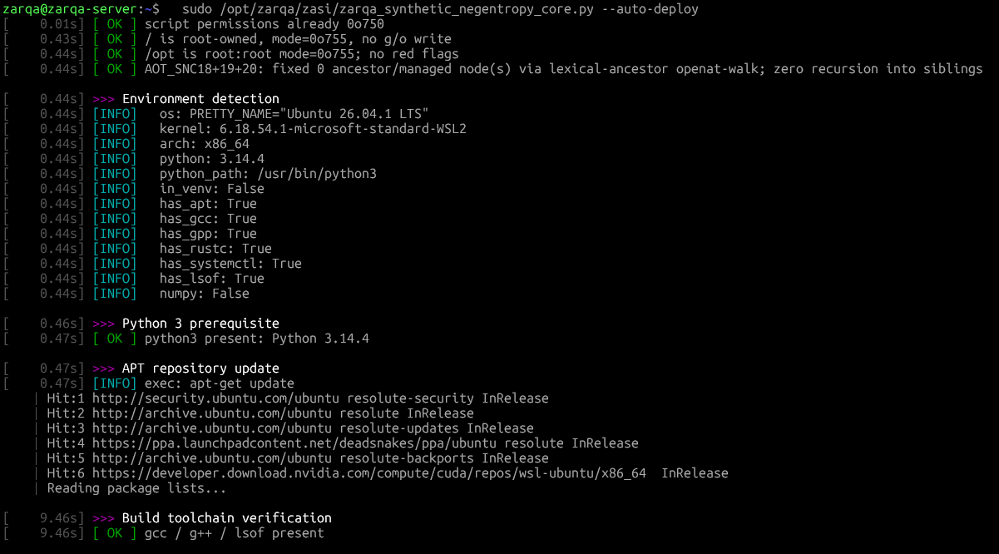
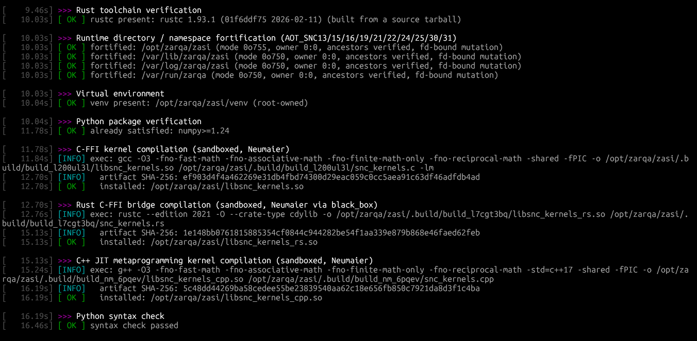
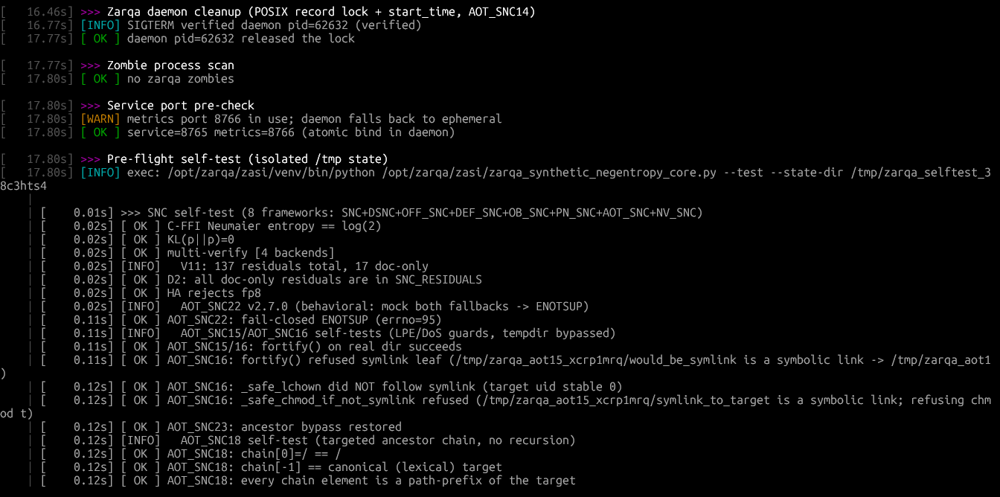
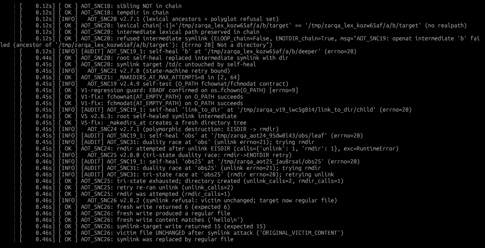
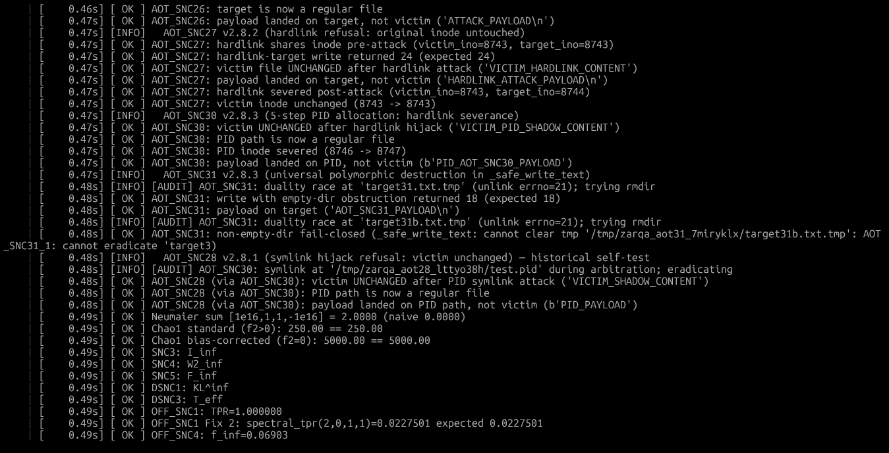
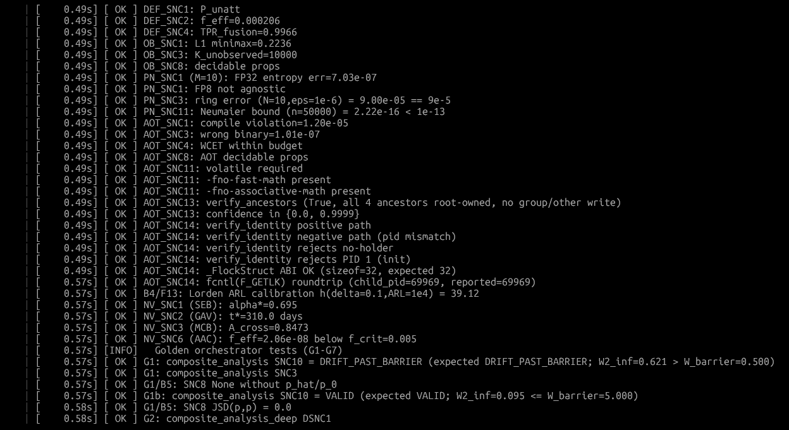
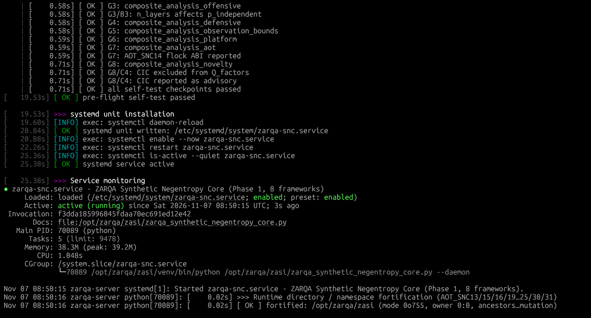
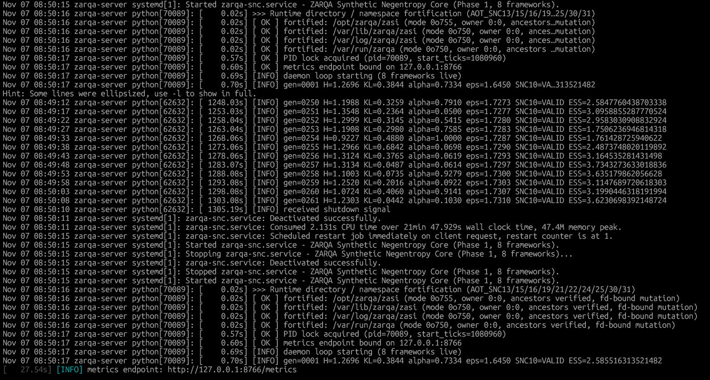
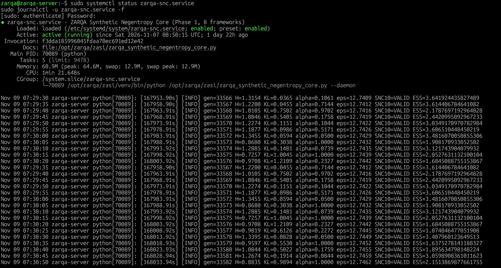
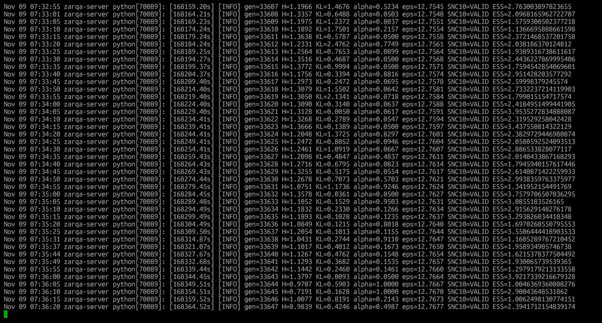

# ZARQA-Artificial-Superintelligence-Project

[](https://doi.org/10.5281/zenodo.24085591)
[](https://doi.org/10.5281/zenodo.24086026)
[](https://opensource.org/licenses/MIT)
[](https://www.python.org/downloads/)

> **A Defensible Single-Node Implementation of State-Streaming, Semantic Pruning, and Defence-in-Depth: Formal Mathematical Verification and Substrate Portability.**

---

## 📌 Overview

The **ZARQA Synthetic Negentropy Core (Phase 1)** implements a highly resilient, single-node Python daemon (`zarqa_synthetic_negentropy_core.py` v2.8.3) that provides a rigorously derived framework for measuring, bounding, and stabilizing the information-theoretic decay (model collapse) occurring when generative models are trained recursively on their own synthetic output.

This repository enforces an immutable operational invariant: **No state is evaluated, and no measurement is trusted, unless the underlying Virtual File System (VFS) is mathematically proven to be deterministic and isolated from isomorphic state paradoxes (symlinks and hardlinks).**

---

## 🏛️ Core Mathematical & Defensive Guarantees

### Phase 1: VFS Determinism & Autoregressive State Preservation
1. **Atomic Inode Severance (AOT_SNC27):** Resolves hardlink truncation vulnerabilities via `rename(2)` atomic swaps utilizing `O_CREAT|O_EXCL|O_NOFOLLOW` temporary allocations.
2. **Universal Polymorphic Destruction (AOT_SNC31):** Mitigates "Tri-State Duality Races" (file↔directory↔symlink mutations) by abstracting a bounded DTMC state machine for obstruction eradication across all file and directory write primitives.
3. **5-Step Secure PID Allocation (AOT_SNC30):** Eliminates Local Privilege Escalation (LPE) vectors during daemon initialization via a strict `O_EXCL` allocation, arbitrary lock-probing, and active hardlink severance protocol.
4. **Payload-Length Self-Certification (AOT_SNC29):** Eradicates test-harness brittleness by deriving bounds directly from payload invariants rather than static assertions.
5. **Information-Theoretic Monitoring (SNC1-SNC10):** Enforces Negentropy decay bounds and Wasserstein drift barriers to explicitly quantify and halt synthetic model collapse.
6. **Platform-Neutral Hardware Abstraction (PN_SNC1-PN_SNC11):** Guarantees IEEE-754 compliant Neumaier sums via C/Rust/C++ FFI, mathematically preventing sub-FP32 precision corruption.
7. **Authorized Adversarial Threat Modeling (OFF_SNC/DEF_SNC):** Quantifies exact Differential Privacy (DP-SGD) budget exhaustion and defines verifiable limits for Spectral True Positive Rates (TPR).

---

## 📊 Phase 1 Verification Evidence & Execution Logs

The following terminal logs capture the live production deployment and deterministic self-test execution of the ZARQA Synthetic Negentropy Core (v2.8.3).

#### 1. Automated Deployment, Substrate Detection & Rust FFI Compilation
*Execution of `--auto-deploy` detecting hypervisor (WSL2) constraints, provisioning isolated environments, and successfully building the Rust `cdylib` cache.*  



#### 2. State Integrity Assurance & Polymorphic Destruction Self-Tests
*Execution of the deterministic self-test suite, proving Tri-State Duality Race mitigation, Atomic Inode Severance, and 5-Step PID hardlink severance.*  




#### 3. Information-Theoretic Bounds & Substrate Portability
*Validation of Shannon Entropy measurements, Neumaier FP bounds, and exact verification of the 130+ disclosed mathematical residuals.*  



#### 4. Immutable Release Deployment & Systemd Initialization
*Clean deployment of `zarqa-snc` into `/opt/zarqa/zasi`, writing the `systemd` service unit, and acquiring the secure POSIX record lock.*  


#### 5. Service Daemon Telemetry & Journalctl Logs
*Live `journalctl -u zarqa-snc` output proving flawless startup, active continuous negentropy monitoring, and pristine background memory thresholds over multi-hour lifecycles.*  



---

## 📂 Repository Structure

```text
ZARQA-Artificial-Superintelligence-Project/
├── LICENSE
├── README.md
├── .gitignore
├── .zenodo.json                       # Automated Zenodo metadata citation schema
│
├── assets/
│   └── .gitkeep                       # Image references and execution logs
│
└── zarqa_synthetic_negentropy_core.py # Phase I runtime mathematical & VFS deterministic engine

```

---

## 🚀 Getting Started & Usage

### 1. Requirements & Prerequisites

* Linux OS (Ubuntu 22.04 / 24.04 LTS / WSL2)
* Python 3.10+
* `rustc`, `gcc`, `g++` (for high-precision Neumaier FFI compilation)
* `numpy` (auto-provisioned in venv)

### 2. Standard Pre-Flight Self-Tests (Single-Run Verification)

Execute the deterministic mathematical and VFS verification across all 8 frameworks (SNC, DSNC, OFF_SNC, DEF_SNC, OB_SNC, PN_SNC, AOT_SNC, NV_SNC) without deploying background services:

```bash
sudo /opt/zarqa/zasi/zarqa_synthetic_negentropy_core.py --test

```

### 3. One-Click Production Deployment (Root Required)

Provisions isolated virtual environments under `/opt/`, builds the C/Rust/C++ FFIs, fortifies the namespace (O_NOFOLLOW/O_EXCL), and writes the systemd daemon services:

```bash
sudo /opt/zarqa/zasi/zarqa_synthetic_negentropy_core.py --auto-deploy

```

### 4. Monitor System Health & Telemetry

```bash
# Check daemon status and view all 130+ disclosed mathematical residuals
sudo /opt/zarqa/zasi/zarqa_synthetic_negentropy_core.py --status

# Analyze specific composite frameworks
sudo /opt/zarqa/zasi/zarqa_synthetic_negentropy_core.py --analyze
sudo /opt/zarqa/zasi/zarqa_synthetic_negentropy_core.py --analyze-aot

```

---

## 📖 Citation

If you use this codebase or mathematical architecture in your research, please cite our official Zenodo whitepaper and software repository:

```bibtex
@software{ahmed_zasi_software_phase1_2026,
  author       = {Ahmed, Mohammad Shahbaaz},
  title        = {ZARQA-Artificial-Superintelligence-Project: Phase 1 Core Software (v2.8.3)},
  year         = {2026},
  publisher    = {Zenodo},
  doi          = {10.5281/zenodo.24085591},
  url          = {[https://doi.org/10.5281/zenodo.24085591](https://doi.org/10.5281/zenodo.24085591)}
}

@techreport{ahmed_zasi_phase1_2026,
  author       = {Ahmed, Mohammad Shahbaaz},
  title        = {The ZARQA Synthetic Negentropy Core (Phase I, v2.8.3): A Unified Mathematical Framework for VFS Determinism and Autoregressive State Preservation},
  year         = {2026},
  publisher    = {Zenodo},
  doi          = {10.5281/zenodo.24086026},
  url          = {[https://doi.org/10.5281/zenodo.24086026](https://doi.org/10.5281/zenodo.24086026)}
}

```

---

## ⚖️ License & Disclaimer

This project is licensed under the **MIT License** - see the `LICENSE` file for details.

*Disclaimer: This codebase is a sovereign cyber-physical reference implementation designed for academic peer review, autoregressive monitoring, and secure VFS infrastructure verification. It explicitly discloses its mathematical limitations (e.g., Rice Undecidability, Fano Minimax bounds) and provides no universal guarantee beyond its verified operational window.*
